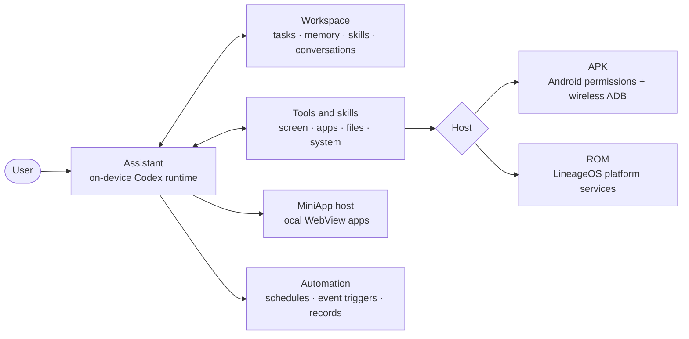
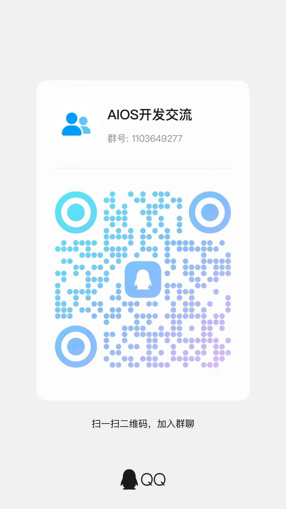

<div align="center">


# AIOS

**Turn Android into a working environment for AI.**

Understands phone context · Keeps tasks moving · Remembers preferences and experience · Learns skills · Builds MiniApps on the spot

[](LICENSE)
[](docs/USAGE.md)
[](docs/BUILDING.md)
[](#current-status)
[](docs/DESIGN.md)

[简体中文](README.zh-CN.md) · [Usage](docs/USAGE.md) · [Building](docs/BUILDING.md) · [Architecture](docs/ARCHITECTURE.md) · [Design](docs/DESIGN.md)

</div>

---

AIOS is an open-source AI assistant runtime for Android that connects phone operations, tasks, memory, skills and automation in a single workspace.

Ask the assistant to act on what is currently on your phone, save important information as long-term memory, turn verified methods into reusable skills, or simply describe what you need and have it write and publish a MiniApp on the device.

AIOS ships in **two forms**: an APK installed on an existing Android system, or a LineageOS-based ROM with deeper system integration.

## Demo

**Give an instruction, watch the assistant work through app downloads and installation, and confirm when authorization is needed.**

https://github.com/user-attachments/assets/5dadf4e1-e295-4734-927d-55849c1b1db7

An actual phone recording showing the task execution workflow.

## Core capabilities

| Capability | What AIOS provides | What it means for you |
|---|---|---|
| **Tasks and continuous work** | Task records, status and progress, linked to related conversations and execution records | Work has a goal and a trail; you can check progress and pick it up again |
| **Long-term memory** | Save, retrieve and maintain personal information and preferences; relevant memories are loaded on demand in later turns | No need to repeat yourself; the assistant continues with existing context |
| **Self-evolution: learning from experience** | Distills experience from verified successful actions, corrections and recoveries into reusable skills; keeps evidence and versions, supports disabling and rollback | Methods that worked can be kept and reused in similar tasks later |
| **Skill system** | Bundled tool guides plus dynamically learned skills, organized by app, domain and purpose, read on demand | Specialized operating knowledge per app and workflow instead of one fixed prompt |
| **Automation** | Scheduled programs, event triggers, execution records and status | Recurring flows run at the right time and you can see what actually happened |
| **Phone context** | Current screen, apps, system state and authorized data/events via host tools, combined with tasks, memory and conversations | The assistant decides the next step from what is happening on the phone, not only from chat text |
| **Phone operation and tool calls** | Screen observation, taps and input, file handling, app management and available system capabilities; approval, intervention and user takeover | From understanding to execution, while you stay in control |
| **MiniApps built on the spot** | Writes HTML/CSS/JavaScript, installs, opens and updates local mini apps with local storage and platform-exposed capabilities | Build checklists, expense trackers or other custom tools and keep iterating on them |

> **Self-evolution means iterating experience and skills, not training model weights online.** Learning is grounded in verifiable process and results; the user's edits, disabling and deletion of skills take precedence.
>
> **The scope of phone context is determined by authorization and the host.** AIOS integrates many kinds of context but does not promise unconditional access to all app-private data, protected screens or information the system does not expose. MiniApps are likewise limited to capabilities the platform actually exposes and authorizes.

## How it works



- The **assistant** runs an on-device Codex runtime that understands requests, plans, calls tools and asks for approval or hands over to you when needed.
- **Workspace** stores the links between tasks, memories, skills and conversations, giving the assistant context across turns and tasks.
- The **host** decides how deep system access goes: Android permissions plus local wireless ADB for the APK, LineageOS platform services for the ROM.
- **Automation** and **MiniApps** share the same business code and are available on both hosts.

Module boundaries and technical limits are described in [Architecture](docs/ARCHITECTURE.md).

## APK vs ROM

The core assistant and Workspace share business code; the difference is how system capabilities are accessed.

| Capability / condition | APK | ROM |
|---|---|---|
| **How you use it** | Install on an existing Android system | Install a LineageOS-based system |
| **Target platform** | Android 15+, ARM64 | Pixel 10 frankel, ARM64, LineageOS 24.0 |
| **Tasks, memory, skills, learning** | Shared core | Shared core |
| **Automation and MiniApps** | Supported; subject to permissions and background policies | Supported; integrated with system services |
| **Phone context and app operation** | Android permissions, local wireless ADB and available host tools | Platform services and system adaptation; permission and security boundaries still apply |
| **Notifications** | Notification reading and events after authorization; no ROM governance module | Adds rules, filtering, importance and summaries |
| **Recording and meeting notes** | ROM module not bundled | System-integrated module |
| **Image/text search** | ROM photo semantic search model not bundled | OpenCLIP-based search; coverage depends on index and model state |
| **Optional components** | Only options actually bundled (speech service, account models) | Additional ROM models and optional app entries; optional third-party apps are not preinstalled |

Validation scope is recorded separately for each form; shared code does not mean every feature has received identical acceptance in both environments. See [optional dependencies](docs/OPTIONAL_DEPENDENCIES.md).

## Getting started

**[Download APK 0.1.11 · ARM64 · 326 MiB](https://github.com/CloudGao/AIOS/releases/download/v0.1.11-apk/AIOS-0.1.11-arm64.apk)** · [Release notes, checksums and corresponding source](https://github.com/CloudGao/AIOS/releases/tag/v0.1.11-apk)

Requires Android 15+. Developer preview; includes the Whisper speech model.

### Current status

Source and the **APK developer preview** are publicly available; ROM binaries have not been published. Both routes currently use the Lineage/Soong build environment with no standalone Gradle build, and some dependencies are not yet publicly hosted.

| Deliverable | Status |
|---|---|
| Source | Public; exported by allow-list without signing keys, credentials or build caches |
| APK | 0.1.11 built locally; signature, alignment, same-signature upgrade and locked-screen speech samples passed. [Download developer preview](https://github.com/CloudGao/AIOS/releases/tag/v0.1.11-apk) |
| ROM | Full product built and passed offline checks; hardware install, boot and data-preserving upgrade not yet accepted. Pixel proprietary redistribution unconfirmed, so still a candidate |

Details: [build acceptance](docs/BUILD_ACCEPTANCE.md), [validation scope](docs/VALIDATION.md) and [freeze and delivery record](docs/RELEASE_FREEZE.md).

### Build from source

Read the [build guide](docs/BUILDING.md) first, then check and restore dependencies from the repository root:

```sh
# Python 3.11+
python3 tools/distribution/dependencies.py check --profile apk
python3 tools/distribution/dependencies.py prepare --profile apk --cache /path/to/dependency-cache
```

Use `--profile rom` for the ROM. The cache is keyed by SHA-256; `--download` fetches only pinned URLs listed in the manifest and reports anything missing. Models, APKs and prebuilt payloads are not committed to Git; see [dependencies and distribution](docs/DISTRIBUTION.md).

### Usage and permissions

First-run setup, account and model configuration, permission grants and wireless ADB pairing are covered in the [usage guide](docs/USAGE.md). Data is managed on the phone; when cloud inference is used, relevant inputs are sent to the service you configure.

## Repository layout

| Path | Contents |
|---|---|
| `android/` | Shared business modules, APK/ROM hosts, speech and UI |
| `integration/`, `patches/` | LineageOS integration and upstream adaptation |
| `examples/miniapps/` | MiniApp examples |
| `tools/` | Build, dependency restore, source export and release tooling |
| `tests/` | Verification code and fixtures |
| `docs/` | Product, architecture, build, usage and acceptance docs |
| `licenses/`, `third_party/` | Third-party licenses, notices and sources |
| `.github/` | Issue and pull request templates |

## Documentation

| To learn about | Read |
|---|---|
| Product capabilities and known limits | [DESIGN.md](docs/DESIGN.md) |
| Modules and technical constraints | [ARCHITECTURE.md](docs/ARCHITECTURE.md) |
| Install, permissions and daily use | [USAGE.md](docs/USAGE.md) |
| Environment and builds | [BUILDING.md](docs/BUILDING.md) |
| What has and has not been verified | [BUILD_ACCEPTANCE.md](docs/BUILD_ACCEPTANCE.md) · [VALIDATION.md](docs/VALIDATION.md) |
| Dependencies, models and release materials | [DISTRIBUTION.md](docs/DISTRIBUTION.md) · [OPTIONAL_DEPENDENCIES.md](docs/OPTIONAL_DEPENDENCIES.md) · [MODEL_REPLACEMENT.md](docs/MODEL_REPLACEMENT.md) |
| Licensing and corresponding source | [LICENSING.md](docs/LICENSING.md) · [CORRESPONDING_SOURCE.md](docs/CORRESPONDING_SOURCE.md) · [THIRD_PARTY_RELEASE_MATERIALS.md](docs/THIRD_PARTY_RELEASE_MATERIALS.md) |

## Roadmap and known gaps

- Hardware install, boot and data-preserving upgrade acceptance for the full ROM.
- Public ROM downloads only after Pixel proprietary redistribution is confirmed.
- Further validation of long-running automation, multi-device compatibility and some interaction flows.
- No APK build path independent of Lineage/Soong yet.

[DESIGN.md](docs/DESIGN.md) and the acceptance records are authoritative; this page does not present planned capabilities as implemented.

## Community and contributing

**QQ community: AIOS开发交流 · 1103649277**

Scan the QR code with QQ or search for the group number to join (primarily Chinese).




Share use cases, skills and MiniApps, and submit reproducible issues and code improvements.

- [Report an issue](https://github.com/CloudGao/AIOS/issues): include APK/ROM, version, device and reproduction steps; remove personal data and credentials.
- [Contributing guide](CONTRIBUTING.md): read before submitting changes.
- [Security](SECURITY.md): read the reporting policy before submitting; do not post sensitive reproduction material.

## License

Original code is licensed under **GPL-3.0-only**; third-party code and models keep their own licenses, unchanged by the repository license. See [LICENSE](LICENSE), [NOTICE](NOTICE), [licensing scope](docs/LICENSING.md) and [third-party release materials](docs/THIRD_PARTY_RELEASE_MATERIALS.md).
