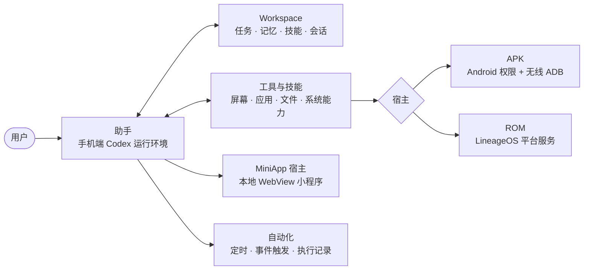
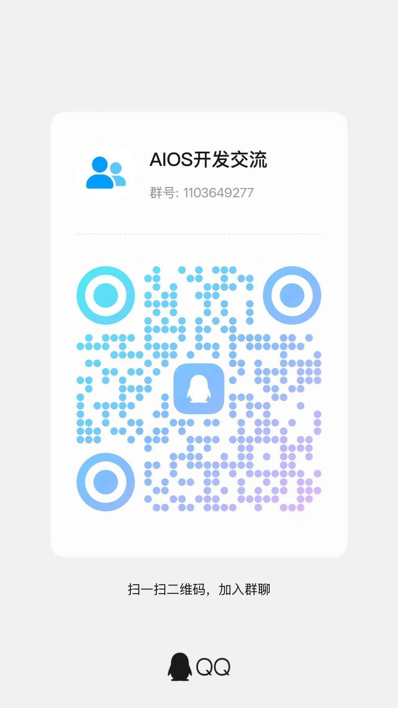

<div align="center">


# AIOS

**让 Android 成为 AI 的工作环境。**

理解手机上下文 · 持续推进任务 · 记住偏好与经验 · 学习技能 · 现场构建小程序

[](LICENSE)
[](docs/USAGE.md)
[](docs/BUILDING.md)
[](#当前状态)
[](docs/DESIGN.md)

[English](README.md) · [使用指南](docs/USAGE.md) · [构建指南](docs/BUILDING.md) · [技术架构](docs/ARCHITECTURE.md) · [产品设计](docs/DESIGN.md)

</div>

---

AIOS 是面向 Android 的开源 AI 助手运行环境，将手机操作、任务、记忆、技能和自动化连接到同一个工作空间。

你可以让助手结合手机当前状态执行操作，把重要信息保存为长期记忆，把经过验证的方法沉淀为技能，也可以直接描述需求，让助手在手机上编写并发布一个可反复使用的 MiniApp。

项目提供 **APK 与 ROM 两种发布形态**：在现有 Android 系统上安装 APK，或通过基于 LineageOS 的 ROM 获得更深入的系统集成。

## 演示

**一句话下达任务，助手调用工具推进应用下载与安装，在需要授权时交回确认。**

https://github.com/user-attachments/assets/5dadf4e1-e295-4734-927d-55849c1b1db7

视频为实际手机操作录屏，展示任务执行流程。

## 核心能力

| 能力 | AIOS 提供什么 | 对使用者意味着什么 |
|---|---|---|
| **任务与持续工作** | 任务记录、状态与进展管理，关联相关会话和执行记录 | 工作有目标、有记录，可以查看进度并继续处理 |
| **长期记忆** | 保存、检索和维护个人信息与偏好，在后续轮次按需加载相关记忆 | 重要信息不必每次重新交代，助手能带着已有上下文继续工作 |
| **自进化：经验学习** | 从已验证的成功操作、纠正及恢复过程中提炼经验，更新可复用技能；保留证据与版本，支持停用和回滚 | 做过并验证有效的方法可以沉淀下来，在后续类似任务中复用 |
| **技能体系** | 随包工具指南与动态学习技能，按应用、领域和用途组织，按需读取方法与资源 | 为不同应用和工作流程积累专门的操作知识，而非只靠一段固定提示词 |
| **自动化** | 定时程序、事件触发、执行记录及状态管理 | 将重复流程安排到合适的时机执行，并查看实际结果 |
| **手机上下文** | 通过宿主工具获取当前界面、应用、系统状态，以及已授权的数据与事件；结合任务、记忆和会话形成工作上下文 | 助手可以结合手机上正在发生的事判断下一步，而不只依赖聊天文字 |
| **手机操作与工具调用** | 屏幕观察、点击输入、文件处理、应用管理及可用系统能力；支持审批、介入和用户接管 | 从理解需求推进到具体执行，过程中仍可由你控制 |
| **现场开发 MiniApp** | 根据需求编写 HTML/CSS/JavaScript，安装、打开和更新本地小程序；使用本地存储，并调用平台已开放的能力 | 可以直接制作清单、记账或其他定制工具，之后继续打开和迭代使用 |

> **自进化的具体含义是经验与技能的迭代，不是在线训练模型权重。** 学习以可验证的过程和结果为依据；用户对技能的编辑、停用和删除决定优先。
>
> **手机上下文的覆盖范围由授权和宿主决定。** AIOS 接入多类上下文，但不承诺无条件读取全部应用私有数据、受保护界面或系统未开放的信息。MiniApp 同样只能使用平台实际开放并授权的能力。

## 工作原理



- **助手**运行手机本地的 Codex 运行环境，负责理解需求、规划、调用工具并在需要时请求你审批或接管。
- **Workspace** 保存任务、记忆、技能和会话之间的关联，是助手跨轮次、跨任务保持上下文的依据。
- **宿主**决定系统能力的接入深度：APK 通过 Android 授权与本机无线 ADB，ROM 通过 LineageOS 平台服务。
- **自动化**与 **MiniApp** 复用同一套业务代码，在两种宿主中都可用。

模块划分与技术限制见 [技术架构](docs/ARCHITECTURE.md)。

## APK 与 ROM：两种发布形态

核心助手与工作空间共用业务代码，差异主要在系统能力的接入方式。

| 能力 / 条件 | APK | ROM |
|---|---|---|
| **使用方式** | 安装到现有 Android 系统 | 安装基于 LineageOS 的定制系统 |
| **目标平台** | Android 15+、ARM64 | Pixel 10 frankel、ARM64、LineageOS 24.0 |
| **任务、记忆、技能与经验学习** | 共享核心能力 | 共享核心能力 |
| **自动化与 MiniApp 开发** | 支持；执行受权限和系统后台策略影响 | 支持；与系统服务集成 |
| **手机上下文与应用操作** | 通过 Android 授权、本机无线 ADB 和可用宿主工具接入 | 通过平台服务及系统适配接入；仍有权限和安全边界 |
| **通知能力** | 授权后的通知读取与事件接入；不包含 ROM 通知治理模块 | 增加通知规则、过滤、重要性与摘要等治理能力 |
| **录音与会议纪要** | 不装配 ROM 录音纪要模块 | 提供系统集成模块 |
| **图文搜索** | 不装配 ROM 照片语义搜索模型 | 提供基于 OpenCLIP 的图文搜索；覆盖范围依赖索引及模型状态 |
| **可选组件** | 仅展示实际装配的语音服务及账号模型等选项 | 额外提供 ROM 模型和可选应用入口；可选第三方应用默认不预装 |

两种形态的验证范围分别记录，共用代码不代表所有功能已经在两种环境中完成相同验收。可选项与默认值见 [可选依赖](docs/OPTIONAL_DEPENDENCIES.md)。

## 开始使用

### 当前状态

当前为**开发者预览源码**，APK 与 ROM 二进制尚未公开发布。两条路线目前均使用 Lineage/Soong 构建环境，没有独立 Gradle 构建；部分依赖尚未公开托管。

| 交付物 | 状态 |
|---|---|
| 源码 | 公开；按白名单导出，不含签名密钥、凭据与构建缓存 |
| APK | 本地已构建 0.1.11；签名、对齐、同签名升级与锁屏语音样本通过。尚未公开下载 |
| ROM | 完整产品已构建并通过离线校验；实机安装、启动与保留数据升级尚未验收。Pixel 专有组件再分发授权未确认，仍为候选包 |

详细范围见 [验收记录](docs/BUILD_ACCEPTANCE.md)、[验证范围](docs/VALIDATION.md) 与 [冻结与交付记录](docs/RELEASE_FREEZE.md)。

### 从源码构建

先阅读 [构建指南](docs/BUILDING.md)，然后在仓库根目录检查并恢复依赖：

```sh
# 需要 Python 3.11+
python3 tools/distribution/dependencies.py check --profile apk
python3 tools/distribution/dependencies.py prepare --profile apk --cache /path/to/dependency-cache
```

ROM 使用 `--profile rom`。依赖缓存按 SHA-256 命名；`--download` 仅下载清单中已有的固定地址，缺项会明确报告。模型、APK 与预编译负载不进入 Git，恢复方式见 [依赖与发行](docs/DISTRIBUTION.md)。

### 使用与授权

安装后的初始化、账号与模型配置、权限授予与无线 ADB 配对见 [使用指南](docs/USAGE.md)。数据在手机本地管理；使用云端推理时，相关输入会发送到你所配置的服务。

## 仓库导航

| 路径 | 内容 |
|---|---|
| `android/` | 公共业务模块、APK/ROM 宿主、语音与界面 |
| `integration/`、`patches/` | LineageOS 集成与上游适配 |
| `examples/miniapps/` | MiniApp 示例 |
| `tools/` | 构建、依赖恢复、源码导出与发行工具 |
| `tests/` | 验证代码与测试样本 |
| `docs/` | 产品、架构、构建、使用与验收说明 |
| `licenses/`、`third_party/` | 第三方许可、声明及相关源码 |
| `.github/` | Issue 与 Pull Request 模板 |

## 文档

| 想了解 | 阅读 |
|---|---|
| 产品能力与已知限制 | [DESIGN.md](docs/DESIGN.md) |
| 模块关系与技术限制 | [ARCHITECTURE.md](docs/ARCHITECTURE.md) |
| 安装、授权与日常使用 | [USAGE.md](docs/USAGE.md) |
| 准备环境与构建 | [BUILDING.md](docs/BUILDING.md) |
| 已验证与未覆盖项 | [BUILD_ACCEPTANCE.md](docs/BUILD_ACCEPTANCE.md) · [VALIDATION.md](docs/VALIDATION.md) |
| 依赖、模型与发行材料 | [DISTRIBUTION.md](docs/DISTRIBUTION.md) · [OPTIONAL_DEPENDENCIES.md](docs/OPTIONAL_DEPENDENCIES.md) · [MODEL_REPLACEMENT.md](docs/MODEL_REPLACEMENT.md) |
| 许可与对应源码 | [LICENSING.md](docs/LICENSING.md) · [CORRESPONDING_SOURCE.md](docs/CORRESPONDING_SOURCE.md) · [THIRD_PARTY_RELEASE_MATERIALS.md](docs/THIRD_PARTY_RELEASE_MATERIALS.md) |

## 路线与已知缺口

- 完整 ROM 的实机安装、启动与保留数据升级验收。
- Pixel 专有组件再分发授权确认后，才能提供 ROM 公开下载。
- 长期自动化、多机型兼容性及部分交互流程的进一步验证。
- 独立于 Lineage/Soong 的 APK 构建路径尚未提供。

状态以 [DESIGN.md](docs/DESIGN.md) 与验收记录为准；本页不把计划中的能力写成已实现。

## 交流与贡献

**QQ 群：AIOS开发交流 · 1103649277**

用 QQ 扫描下方二维码，或搜索群号加入。




欢迎交流使用场景、分享技能和 MiniApp，也欢迎提交可复现的问题与代码改进。

- [报告问题](https://github.com/CloudGao/AIOS/issues)：请注明 APK/ROM、版本、设备与复现步骤，并移除个人数据与凭据。
- [贡献指南](CONTRIBUTING.md)：提交改动前请先阅读。
- [安全反馈](SECURITY.md)：请先阅读安全反馈规则，不要公开敏感复现材料。

## 许可

自有代码采用 **GPL-3.0-only**；第三方代码与模型保留各自许可，不因仓库许可而改变。详见 [LICENSE](LICENSE)、[NOTICE](NOTICE)、[许可范围](docs/LICENSING.md) 和 [第三方发行材料](docs/THIRD_PARTY_RELEASE_MATERIALS.md)。
